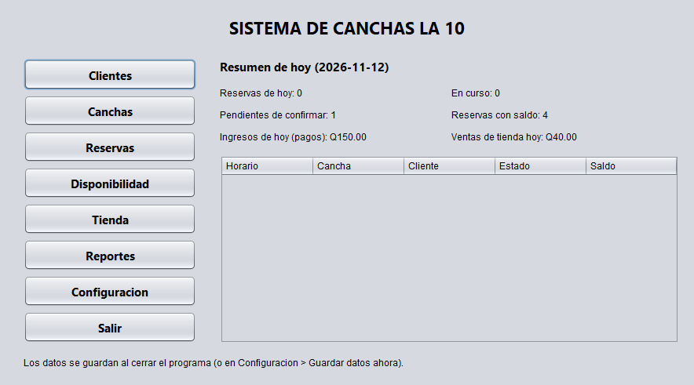
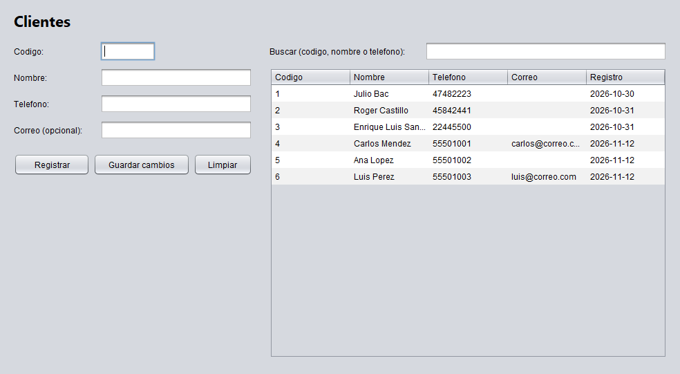
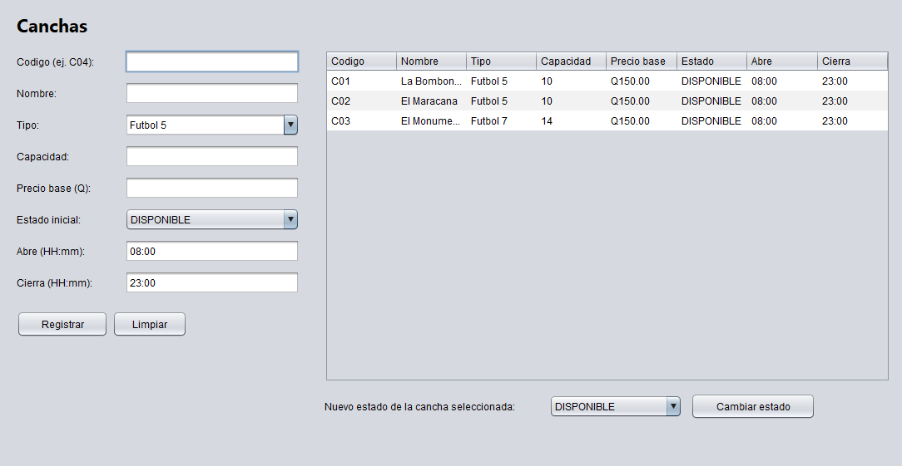
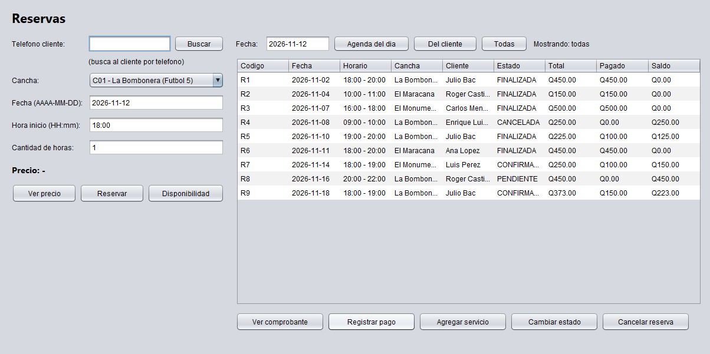
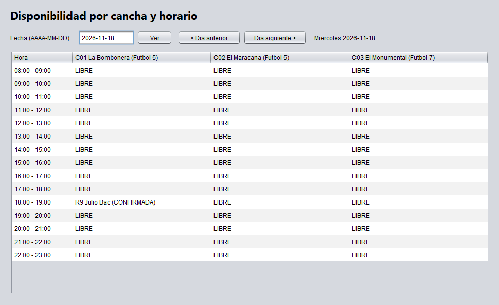
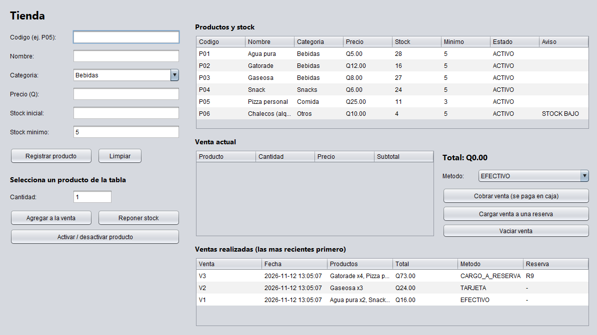
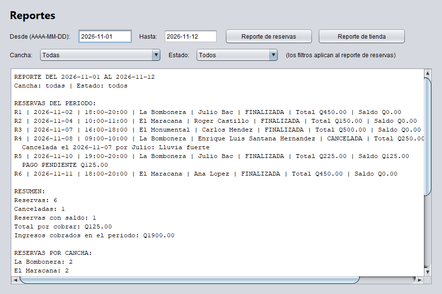
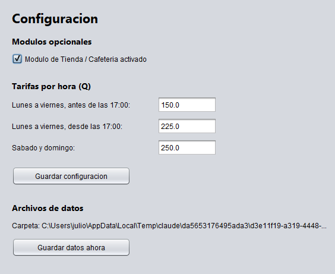

# CanchaPro — Documento técnico

Proyecto final de Programación 2 · Universidad Mariano Gálvez de Guatemala
Caso de estudio: Complejo Deportivo "La 10"

## 1. Descripción

CanchaPro administra las reservas de un complejo de canchas sintéticas. Reemplaza el control por WhatsApp y cuaderno, que provocaba reservas duplicadas, anticipos perdidos y saldos desconocidos.

El sistema:

- Registra clientes y canchas.
- Decide automáticamente si una cancha está disponible y rechaza los traslapes de horario.
- Calcula el precio según el día y la hora.
- Lleva los pagos, el saldo y los servicios adicionales de cada reserva.
- Conserva el historial completo, incluidas las reservas canceladas.
- Tiene un módulo opcional de Tienda / Cafetería con inventario y ventas.
- Genera reportes de operación, ingresos y demanda.
- Guarda todo en archivos CSV y lo reconstruye al iniciar.

## 2. Organización del código

El programa está separado en capas. La interfaz nunca escribe en los archivos ni decide reglas: solo pide datos y llama a los gestores.

| Capa | Clases | Responsabilidad |
|---|---|---|
| Modelo | `Cliente`, `Cancha`, `Reserva`, `ServicioAdicional`, `Pago`, `Producto`, `Venta`, `DetalleVenta` | Datos de cada objeto y sus propias reglas |
| Gestores | `gestorClientes`, `GestorCanchas`, `gestorReserva`, `GestorTienda` | Guardan los objetos en arreglos y aplican las reglas del negocio |
| Cálculo | `Tarifa`, `reportes`, `Formato` | Precio de una reserva, reportes y formato de dinero |
| Configuración | `Configuracion` | Activar o desactivar el módulo de tienda |
| Persistencia | `Archivos` y una clase por archivo | Leer y escribir los CSV |
| Interfaz | paquete `vistas` (8 JFrame) y `MenuConsola` | Pantallas |
| Arranque | `ProyectoCanchaLa10` | Carga los datos, abre la interfaz y guarda al cerrar |

El diagrama de clases está en [UML.md](UML.md).

## 3. Clases principales

### Modelo

- **`Cliente`**: código, nombre, teléfono, correo opcional y fecha de registro.
- **`Cancha`**: código, nombre, tipo, capacidad, precio base, estado y horario de apertura y cierre.
- **`Reserva`**: es la clase central. Guarda la referencia a su `Cliente` y a su `Cancha`, la fecha, la hora de inicio, la hora final (se calcula con `inicio.plusHours(horas)`), el total y el estado. Contiene un arreglo de `ServicioAdicional` y otro de `Pago`. El saldo no se guarda: `getSaldo()` lo calcula como total menos lo pagado.
- **`Pago`**: código, fecha y hora, monto, método y observación.
- **`ServicioAdicional`**: nombre y precio (balón, árbitro, chalecos o un producto de la tienda).
- **`Producto`**: código, nombre, categoría, precio, existencia, stock mínimo y estado.
- **`Venta`** y **`DetalleVenta`**: una venta tiene uno o varios detalles; cada detalle es un producto con su cantidad y precio unitario. El total de la venta se calcula sumando los subtotales.

### Gestores

- **`gestorClientes`**: registra, edita y busca clientes. No permite dos clientes con el mismo teléfono.
- **`GestorCanchas`**: registra canchas y cambia su estado.
- **`gestorReserva`**: motor de disponibilidad, creación de reservas, pagos, comprobante e indicadores del día.
- **`GestorTienda`**: productos, inventario y ventas.

## 4. Reglas de negocio

### Disponibilidad y traslape

Están en `gestorReserva.disponible()` y `gestorReserva.ocupante()`.

Una cancha se puede reservar solo si:

1. Su estado es `DISPONIBLE` (una cancha en mantenimiento o inactiva nunca aparece libre).
2. La duración es de 1 a 12 horas.
3. El horario cae dentro de la apertura y el cierre de la cancha.
4. Ninguna reserva activa la ocupa en ese horario.

Hay conflicto cuando:

```
inicioNuevo < finExistente   Y   finNuevo > inicioExistente
```

Por eso una reserva que empieza justo cuando termina otra sí se acepta. Las reservas canceladas no ocupan la cancha. La comparación usa `LocalDate` y `LocalTime`.

### Tarifas

Están en `Tarifa.calcular()`. Se usa la tarifa de la hora inicial (nivel medio).

| Condición | Tarifa de referencia |
|---|---|
| Lunes a viernes antes de las 17:00 | Q150 por hora |
| Lunes a viernes desde las 17:00 | Q225 por hora |
| Sábado y domingo | Q250 por hora |

Los valores se leen de `tarifas.csv` y se cambian en la pantalla de Configuración. El precio base de la cancha equivale a la tarifa de día; si una cancha tiene otro precio base, las demás tarifas cambian en la misma proporción.

### Estados de una reserva

```
PENDIENTE --(primer pago)--> CONFIRMADA --> EN_CURSO --> FINALIZADA
     \___________________________|______________|
                    cancelar --> CANCELADA
```

- Una reserva nueva nace `PENDIENTE` y pasa a `CONFIRMADA` con su primer pago (`Reserva.agregarPago`).
- `Reserva.cambiarEstado` solo permite `CONFIRMADA → EN_CURSO` y `EN_CURSO → FINALIZADA`.
- Una reserva `FINALIZADA` o `CANCELADA` ya no cambia de estado.
- Cancelar exige motivo y operador, guarda la fecha y **no borra** la reserva.

### Pagos

- Una reserva tiene una colección de pagos, no un solo anticipo.
- No se aceptan pagos de cero, negativos ni mayores al saldo.
- No se aceptan pagos en una reserva cancelada.
- El sistema no maneja devoluciones.

### Servicios adicionales

Se agregan con `Reserva.agregarServicio`, que suma su precio al total. Una reserva admite hasta 10 servicios y no se pueden agregar si está cancelada o finalizada.

### Tienda

- Una venta se arma en tres pasos: `nuevaVenta()`, `agregarAVenta()` por cada producto y `confirmarVenta()`.
- El inventario se descuenta solo al confirmar, y solo si todo es válido.
- No se puede vender más de la existencia, ni un producto inactivo.
- Una venta puede ser suelta (se paga en caja con un método de pago) o cargarse a una reserva. En el segundo caso cada producto queda como servicio adicional y se cobra con la reserva.
- El módulo se activa o desactiva con `modulo_tienda` en `configuracion.txt`. Las reservas no dependen de la tienda.

## 5. Persistencia

Modelo de trabajo: **archivos → lectura y validación → objetos Java → reglas e interfaz → escritura**.

- Al iniciar, `Archivos.cargar()` lee los CSV y reconstruye los objetos. El orden importa: primero clientes y canchas, luego reservas (que los referencian), luego servicios y pagos.
- Mientras el programa funciona, solo interactúan objetos.
- Al cerrar, un *shutdown hook* llama a `Archivos.guardar()`, que escribe todos los archivos. También se puede guardar en cualquier momento desde Configuración.
- Cada línea se lee dentro de un `try/catch`: si está dañada, se omite con un aviso y se continúa con la siguiente.
- Si un archivo no existe, se usan los datos por defecto.

La lista de archivos y sus columnas está en el [README](../README.md).

## 6. Recorrido de una operación: crear una reserva

1. En `FrmReservas` el operador escribe el teléfono y presiona **Buscar**. La pantalla llama a `gestorClientes.buscarTelefono()`. Si no existe, ofrece registrarlo con `gestorClientes.registrar()`.
2. Elige cancha, fecha, hora y duración, y presiona **Reservar**.
3. `FrmReservas.reservar()` convierte los textos a `LocalDate`, `LocalTime` e `int`. Si un dato es inválido muestra el error y no continúa.
4. Llama a `gestorReserva.disponible()`. El gestor revisa el estado de la cancha, su horario y el traslape con `ocupante()`.
5. Muestra el precio que devuelve `Tarifa.calcular()` y pide confirmación.
6. Llama a `gestorReserva.registrar()`, que vuelve a validar, crea el objeto `Reserva` en estado `PENDIENTE` y lo guarda en su arreglo.
7. Si se registra un pago, `gestorReserva.pagar()` crea el `Pago` y `Reserva.agregarPago()` lo valida contra el saldo y cambia el estado a `CONFIRMADA`.
8. Al cerrar el programa, `ArchivosReservas` y `ArchivosPagos` escriben la reserva y sus pagos en los CSV.

## 7. Reportes

`reportes.resumen()` recorre los objetos y produce, para un rango de fechas y con filtros opcionales de cancha y estado:

- Reservas del período.
- Reservas canceladas, con motivo y operador.
- Pagos pendientes y total por cobrar.
- Ingresos cobrados en el período (suma de pagos por fecha de pago).
- Reservas por cancha y cancha más utilizada.
- Las 3 horas de mayor demanda.
- Los 5 clientes con más reservas.

`GestorTienda.reporte()` da ventas sueltas y cargadas a reservas, unidades, ticket promedio, ingresos por categoría, producto más vendido y productos con stock bajo.

## 8. Manejo de errores

| Situación | Cómo se controla |
|---|---|
| Archivo inexistente | Se usan datos por defecto |
| Línea dañada en un archivo | Se omite con aviso (`try/catch` por línea) |
| Fecha, hora o número inválido | La pantalla muestra el error y no ejecuta la operación |
| Cliente o cancha inexistente | El gestor devuelve `null` y la pantalla avisa |
| Conflicto de horario o cancha en mantenimiento | `gestorReserva.disponible()` devuelve `false` |
| Pago mayor al saldo o negativo | `Reserva.agregarPago()` lo rechaza |
| Venta con inventario insuficiente | `GestorTienda.agregarAVenta()` y `confirmarVenta()` la rechazan |

## 9. Pruebas funcionales

Pruebas de la sección 17 del enunciado, ejecutadas contra los gestores:

| # | Prueba | Resultado esperado | Resultado |
|---|---|---|---|
| 1 | Reserva en horario disponible | Aceptada | Correcto |
| 2 | Reserva exactamente después de otra | Aceptada | Correcto |
| 3 | Reserva parcialmente traslapada | Rechazada | Correcto |
| 4 | Reserva contenida dentro de otra | Rechazada | Correcto |
| 5 | Reserva en cancha en mantenimiento | Rechazada | Correcto |
| 6 | Pago parcial | Saldo actualizado | Correcto |
| 7 | Pago total | Saldo Q0 | Correcto |
| 8 | Pago mayor al saldo | Rechazado | Correcto |
| 9 | Cancelar reserva | Conserva historial | Correcto |
| 10 | Reiniciar programa | La información permanece | Correcto |
| 11 | Archivo con registro incorrecto | Error controlado | Correcto |
| 12 | Reporte mensual | Totales correctos | Correcto |
| 13 | Venta con stock disponible | Disminuye inventario | Correcto |
| 14 | Venta mayor a existencia | Rechazada | Correcto |

Pruebas adicionales que también pasaron:

- Venta con varios productos: el total se calcula y el inventario se descuenta solo al confirmar.
- Venta cargada a una reserva: suma al total de la reserva.
- Una reserva cancelada no acepta ventas y el inventario no cambia.
- Un producto inactivo no se puede vender.
- Las tarifas configuradas se guardan en `tarifas.csv` y se recuperan al reiniciar.
- `modulo_tienda=false` se guarda y se lee de `configuracion.txt`.
- Los reportes filtran por cancha y por estado.
- La búsqueda de clientes funciona por código, nombre y teléfono.

## 10. Capturas

### Inicio


### Clientes


### Canchas


### Reservas


### Disponibilidad


### Tienda


### Reportes


### Configuración


## 11. Limitaciones conocidas

- La tarifa se toma de la hora inicial; no se divide una reserva que cruza dos franjas.
- Los datos se escriben al cerrar el programa o con "Guardar datos ahora". Si el programa se cierra a la fuerza, se pierde lo trabajado desde el último guardado.
- Los gestores usan arreglos de tamaño fijo: 100 clientes, 30 canchas, 500 reservas y 50 productos.
- No hay devoluciones de dinero.
- Las fechas y horas se escriben como texto (`AAAA-MM-DD` y `HH:mm`).

## 12. Conclusiones

- Separar el modelo, los gestores, los archivos y las pantallas permitió tener dos interfaces (ventanas y consola) sobre las mismas reglas, sin duplicarlas.
- La regla de traslape quedó en un solo método (`gestorReserva.ocupante`), así que un cambio en ella afecta de una vez a la creación de reservas, a la consulta de disponibilidad y a la vista por horario.
- Calcular el saldo y los totales en lugar de guardarlos evita que los datos queden inconsistentes.
- Guardar las cancelaciones como un estado, y no borrar la reserva, conserva el historial que el negocio necesita para sus reportes.
