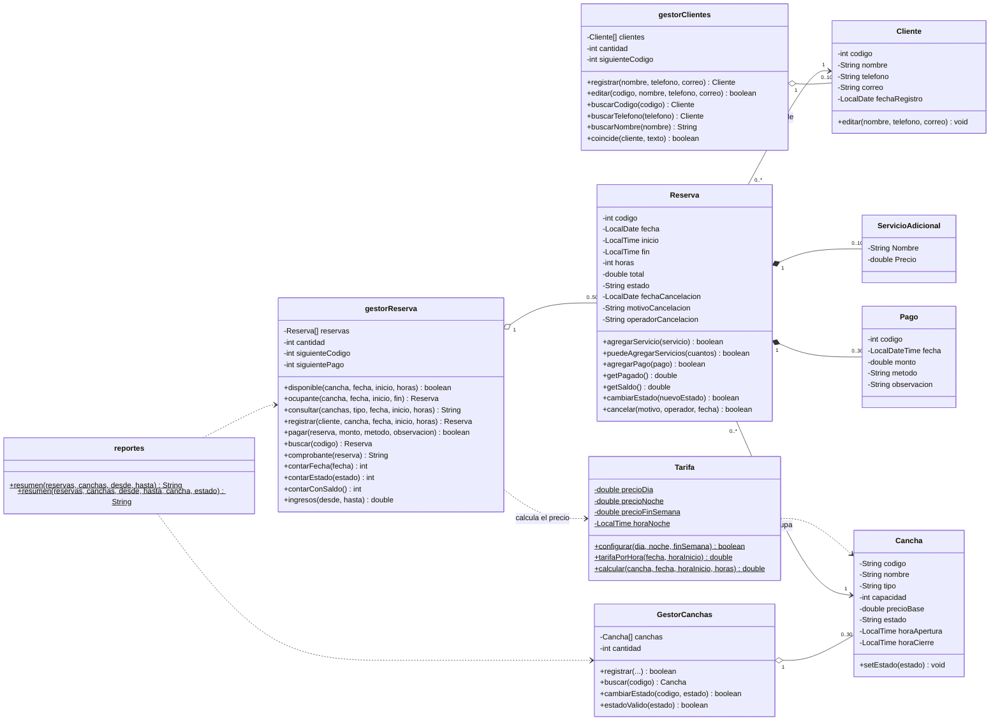
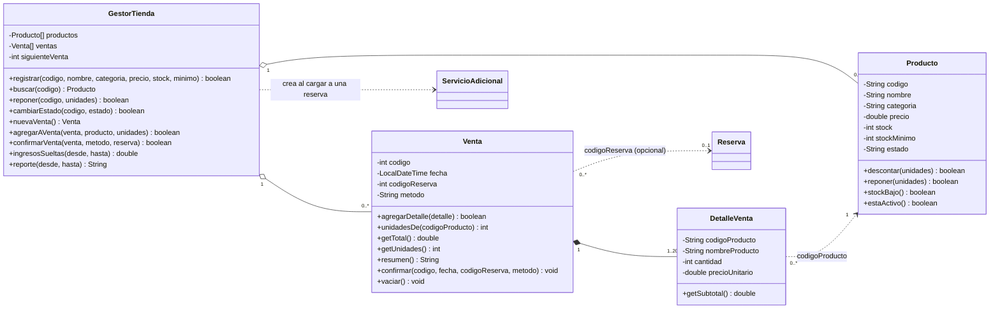
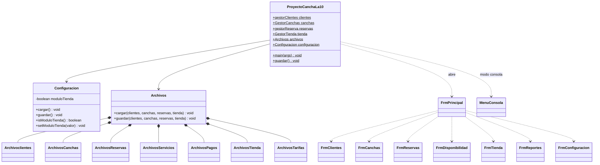

# Diagrama de clases UML — CanchaPro

Este diagrama representa el código que está implementado. Está escrito en Mermaid: GitHub lo dibuja automáticamente al abrir este archivo, y también se puede pegar en <https://mermaid.live> para exportarlo como imagen.

## Modelo y gestores

## Módulo de Tienda

## Persistencia, configuración e interfaz

Cada JFrame usa los gestores que necesita (por ejemplo, `FrmReservas` usa `gestorClientes`, `GestorCanchas` y `gestorReserva`). Los JFrame heredan de `javax.swing.JFrame`.

## Notas de diseño

- **Composición:** los `Pago` y los `ServicioAdicional` solo existen dentro de su `Reserva`; los `DetalleVenta` solo existen dentro de su `Venta`.
- **Asociación:** una `Reserva` guarda la referencia a su `Cliente` y a su `Cancha` (objetos, no códigos).
- **Agregación:** cada gestor guarda sus objetos en un arreglo con un contador.
- **Estados:** son textos con valores fijos, validados por el modelo.
  - Cancha: `DISPONIBLE`, `MANTENIMIENTO`, `INACTIVA`.
  - Reserva: `PENDIENTE`, `CONFIRMADA`, `EN_CURSO`, `FINALIZADA`, `CANCELADA`.
  - Producto: `ACTIVO`, `INACTIVO`.
- **Herencia:** no se usa entre las clases del modelo porque no hay una relación "es un" real entre ellas; solo los JFrame heredan de `JFrame`.
